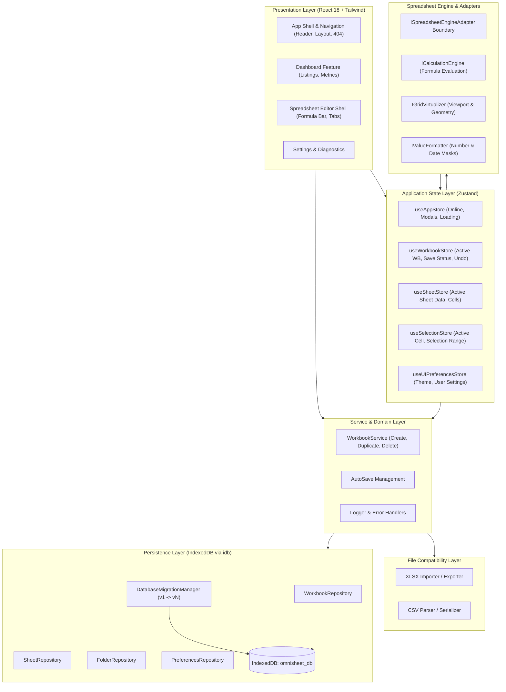

# System Architecture & Layer Boundaries

**Project:** OmniSheet  
**Date:** November 2026  
**Document:** `docs/ARCHITECTURE.md`  

---

## 1. Architectural Principles

OmniSheet is architected as a **local-first, offline-resilient, modular desktop/web spreadsheet application**. It strictly enforces the following core architectural mandates:

1. **Strict Layer Separation:** Presentation components never touch IndexedDB or calculate formula graphs directly.
2. **UI Independence:** Workbook and sheet data structures are completely detached from React UI state.
3. **Sparse Memory Management:** Memory footprint is proportional only to populated cells, preventing browser crashes on million-row spreadsheets.
4. **Adapter Isolation:** The spreadsheet computation engine and grid renderer sit behind generic adapter boundaries (`ISpreadsheetEngineAdapter`), preventing vendor lock-in.
5. **Zero Cloud Requirement:** The application functions with 100% feature parity offline.

---

## 2. Layer Architecture Diagram

---

## 3. Module Responsibilities

### 3.1 Presentation Layer (`src/app/`, `src/components/`, `src/features/`)
- Pure React components responsible for DOM rendering, accessibility, and dispatching user actions to Zustand stores or domain services.
- **Rules:**
  - Forbidden from directly calling `indexedDB` or `openDB`.
  - Forbidden from embedding formula parsing or AST evaluation logic inside JSX.
  - Subscribed to localized Zustand store selectors to prevent unnecessary re-renders.

### 3.2 Application State Layer (`src/stores/`)
- Five decoupled Zustand stores maintain in-memory application lifecycle:
  - `useAppStore`: Transient network status (`isOnline`), modal overlays, global loading spinners.
  - `useWorkbookStore`: Active workbook metadata, list of sheet summaries, persistence status (`idle`, `saving`, `saved`, `error`), undo/redo states.
  - `useSheetStore`: Current active sheet cells (`SparseCellMap`), row heights, column widths.
  - `useSelectionStore`: Active coordinate (`activeCell`), highlighted range (`selectedRange`), edit cell coordinate.
  - `useUIPreferencesStore`: Theme (`light`, `dark`, `system`), grid display defaults, auto-save timers.

### 3.3 Domain & Service Layer (`src/services/`, `src/utils/`)
- Business workflows orchestrating multiple domain operations (e.g., creating a workbook requires creating an initial default sheet and committing both in a coordinated transaction).
- Coordinates debounced auto-saving and recovery snapshots.

### 3.4 Spreadsheet Engine Layer (`src/engine/`)
- Isolated behind `ISpreadsheetEngineAdapter` and `ICalculationEngine`.
- Decouples formula calculation, range referencing, and viewport virtualization from React component lifecycles.
- Allows upgrading or swapping calculation algorithms without touching storage schemas or UI views.

### 3.5 Storage Layer (`src/storage/`)
- Implements the Repository Pattern over IndexedDB (`idb`).
- Handles object stores (`workbooks`, `sheets`, `folders`, `preferences`, `backups`).
- Implements versioned schema migrations via `DatabaseMigrationManager`.
- Intercepts and transforms browser `QuotaExceededError` exceptions into actionable domain errors.

### 3.6 File Compatibility Layer (`src/engine/compatibility/`)
- Manages bi-directional transformation between external spreadsheet formats (XLSX, CSV) and internal `Workbook` / `Sheet` models.

---

## 4. In-Memory vs. Persistent State Matrix

| State Data | In-Memory (Zustand) | Persistent (IndexedDB) | Rationale |
| :--- | :---: | :---: | :--- |
| **Active Workbook ID** | Yes | Yes | Needed for active editing session; reloaded from URL params or storage. |
| **All Populated Cells** | Yes (Active Sheet) | Yes (All Sheets) | Active sheet is kept in memory for high-frequency editing; persisted via debounced auto-save. |
| **Selection Range (e.g., A1:B10)** | Yes | No | Highly transient UI state; resetting on page reload is expected spreadsheet behavior. |
| **Scroll Offsets / Viewport** | Yes | Optional (Metadata) | Transient navigation state. |
| **Online / Offline Network State** | Yes | No | Derived dynamically from browser event listeners (`window.ononline`). |
| **User Preferences & Theme** | Yes | Yes | Persisted to IndexedDB with localStorage fallback to prevent theme flickering on boot. |
| **Undo / Redo Stacks** | Yes | No | Ephemeral per-session stack to maintain lean storage performance. |
