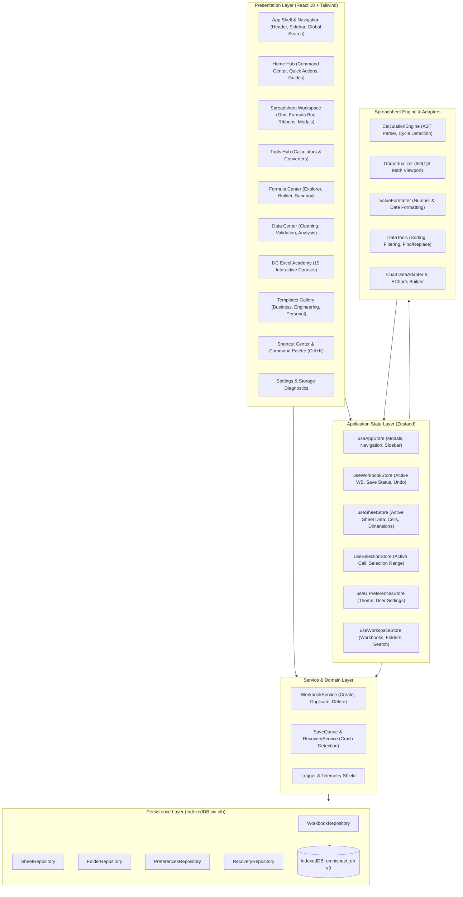

# DC Excel — System Architecture & Layer Boundaries

**Brand:** Damayanti Crest  
**Product:** DC Excel  
**Tagline:** Create. Calculate. Analyse.  
**Date:** November 2026  
**Document:** `docs/ARCHITECTURE.md`

---

## 1. Architectural Principles

DC Excel is architected as an **independent, local-first, offline-resilient desktop/web productivity and spreadsheet platform**. It enforces the following core architectural mandates:

1. **Strict Layer Separation:** Presentation components never access IndexedDB or calculate formula graphs directly.
2. **UI Independence:** Workbook and sheet data structures are decoupled from React UI state.
3. **Sparse Memory Model:** Memory footprint is proportional only to populated cells, preventing browser crashes on million-row spreadsheets.
4. **$O(1)$ Arithmetic Virtualization:** Row and column rendering utilizes constant-time coordinate projection without pre-allocating millions of DOM nodes or prefix-sum arrays.
5. **Zero Cloud Requirement:** Complete feature parity offline with zero telemetry and 100% client-side privacy.
6. **Hub Modularity:** Standalone productivity hubs (Tools Hub, Formula Center, Data Center, DC Excel Academy, Templates, Shortcut Center) run in dedicated routes while integrating seamlessly with the Workbook Workspace.

---

## 2. Layer Architecture Diagram

---

## 3. Product Hub Architecture

DC Excel provides 9 distinct application areas:

1. **Home**: Productivity command center with welcome banner, unified global search, quick action cards, recent files, template highlights, and beginner quick guides.
2. **Workbook Workspace**: High-performance spreadsheet editor supporting up to 1,048,576 rows and 16,384 columns, formula bar, name box, sheet tabs, cell formatting, charts, and data tools.
3. **Tools Hub**: Integrated calculators (Scientific, Engineering, Financial, Statistics) and Universal Unit Converter with "Insert into Cell" capability.
4. **Formula Center**: Searchable formula library across 8 categories, interactive visual formula builder, and sandboxed tester.
5. **Data Center**: Data cleaning, text-to-columns, deduplication, data validation, and descriptive statistics.
6. **DC Excel Academy**: 19 offline-capable interactive courses with guided exercises, challenges, and local progress tracking.
7. **Templates**: Pre-designed, functional spreadsheet templates ready for 1-click instantiation.
8. **Shortcut Center & Command Palette**: Comprehensive keyboard shortcut database with interactive practice and `Ctrl+K` command launcher.
9. **Settings & Storage**: Theme configuration, locale preferences, autosave timers, storage quota analytics, and JSON backup/restore.
