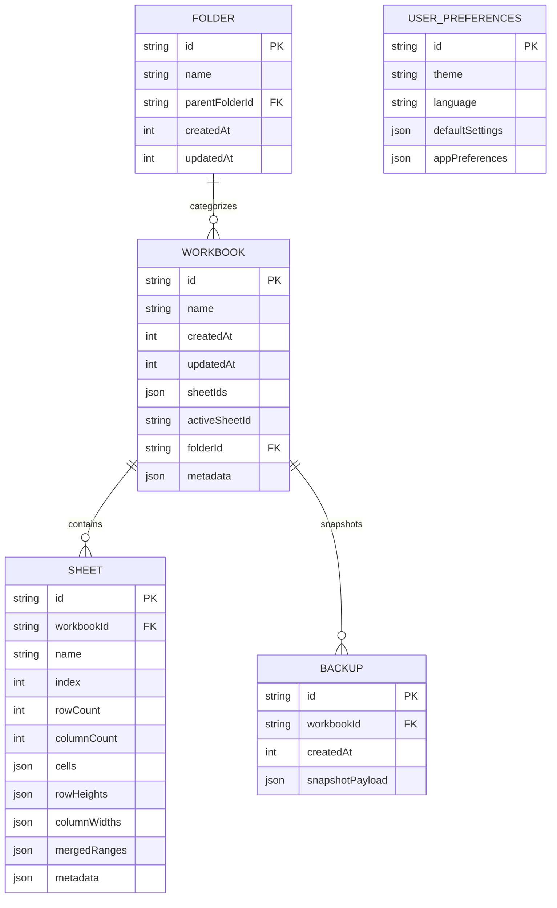

# Local Storage Architecture & IndexedDB Design

**Project:** OmniSheet  
**Date:** November 2026  
**Document:** `docs/STORAGE_DESIGN.md`  

---

## 1. Architectural Philosophy: Local-First & Storage Isolation

OmniSheet operates entirely client-side. All workbook definitions, sheets, cell values, styles, and user preferences are persisted inside the client's browser environment using **IndexedDB**.

### Why Not `localStorage`?
- **Capacity:** `localStorage` is synchronously limited to ~5 MB per domain in most browsers. A single spreadsheet with 50,000 cells exceeds this limit rapidly.
- **Thread Blocking:** `localStorage` is synchronous and blocks the main UI rendering thread during serialization and writing.
- **Query Flexibility:** `localStorage` is a flat key-value string store lacking indices, transactions, and cursors.
- **IndexedDB Role:** All heavy domain models (workbooks, sheets, cells, folders, backups) live strictly in IndexedDB. `localStorage` is reserved solely as a lightweight emergency fallback for basic user preferences (such as dark/light theme).

---

## 2. Sparse Cell Storage Model

### 2.1 The Problem with 2D Arrays
Spreadsheets standardly present grids with 1,000,000 rows and 16,384 columns (16.384 billion cell intersections). Storing a 2D dense matrix (`Cell[][]`) allocates memory and disk space for billions of empty, unformatted cells, quickly causing browser tab crashes and out-of-memory errors.

### 2.2 Sparse Map Representation
OmniSheet represents spreadsheet cells using a **Sparse Coordinate Hash Map** (`SparseCellMap`):

```typescript
export type SparseCellMap = Record<string, Cell>;
```

- **Key Format:** `"${row}:${col}"` (0-indexed integer coordinates, e.g., `"0:0"` for A1, `"4:12"` for M5).
- **Storage Economy:** An empty sheet occupies only a few bytes (`{}`). Only cells with explicit values, formulas, custom styles, or metadata are instantiated.
- **Lookup Performance:** O(1) direct dictionary access for rendering and formula retrieval.
- **Coordinate Transformations:** Pure mathematical utility functions (`coordToKey`, `keyToCoord`, `coordToA1`, `a1ToCoord`, `rangeToA1`) handle bidirectional translation with zero memory overhead.

---

## 3. Database Schema Specification

- **Database Name:** `omnisheet_db`
- **Current Version:** `1`



### 3.1 Object Store: `workbooks`
- **Primary Key:** `id` (string, UUID)
- **Indices:**
  - `folderId`: For querying workbooks belonging to a specific directory.
  - `updatedAt`: For sorting dashboard lists chronologically.
  - `name`: For search and alphabetical filtering.

### 3.2 Object Store: `sheets`
- **Primary Key:** `id` (string, UUID)
- **Indices:**
  - `workbookId`: For retrieving all worksheets associated with an active workbook.
  - `index`: Compound index `['workbookId', 'index']` for ordered tab ordering.
- **Payload:** Contains `cells` (`SparseCellMap`), custom `rowHeights`, `columnWidths`, and `mergedRanges`.

### 3.3 Object Store: `folders`
- **Primary Key:** `id` (string, UUID)
- **Indices:**
  - `parentFolderId`: Supports hierarchical nested folder structures.
  - `name`: For folder display sorting.

### 3.4 Object Store: `preferences`
- **Primary Key:** `id` (constant `'current_user_preferences'`)
- Holds application settings, theme (`light` | `dark` | `system`), grid defaults, and auto-save timing.

### 3.5 Object Store: `backups`
- **Primary Key:** `id` (string, UUID)
- **Indices:**
  - `workbookId`: Queries historical revisions for a given workbook.
  - `createdAt`: For pruning snapshots older than the configured retention threshold.

---

## 4. Database Migrations Pipeline

Schema evolution is governed by `DatabaseMigrationManager` (`src/storage/migrations/migration-manager.ts`):
1. **Version Tracking:** The IndexedDB `onupgradeneeded` event compares `oldVersion` against the incoming target version.
2. **Sequential Steps:** Migrations are registered as discrete executable steps (`migrations.set(v, (db, oldV, newV) => ...)`).
3. **Non-Destructive Upgrades:** Existing stores and indices are inspected (`!db.objectStoreNames.contains(...)`) before creation to prevent data loss.

---

## 5. Storage Reliability & Quota Management

### 5.1 Storage Quota Monitoring
Modern browsers allocate storage based on available disk space (typically 10%–60% of free storage). OmniSheet monitors available storage using `navigator.storage.estimate()`:
- Displayed transparently in the application Settings view.
- Provides proactive warnings when usage reaches 85% of allocated quota.

### 5.2 Quota Exceeded Handling
All storage writes are routed through `handleStorageOperation<T>()`:
- Catches browser `QuotaExceededError` exceptions.
- Translates native browser errors into typed domain `QuotaExceededError`.
- Prevents unhandled promise rejections and informs the user to free space or export workbooks to disk.

### 5.3 Incognito / Private Browsing Fallback
When running in privacy-hardened browsers where IndexedDB might be disabled or cleared on tab closure:
- Initialization errors are captured by `AppProviders`.
- User preferences gracefully fall back to in-memory / session persistence.
- Users receive a clear warning before proceeding.
